<div align="center">
  
  <h1>Islamic</h1>
  <p><strong>A worship-first companion for prayer, Qur'an, remembrance and daily practice.</strong></p>
  <p>
    
    
    
    
    
  </p>
  <p>
    <code>com.qashi.islamic</code> · version <code>2.0.0</code> · 77 screens · no account, no tracking
  </p>
</div>

---

Islamic brings the five daily prayers, the whole Qur'an, authentic hadith, dhikr and the
calculators a practising Muslim reaches for into one app that works offline, speaks 22
languages, and keeps everything it learns about you on the device.

- **Prayer times** for any city, with seven calculation methods and real adhan alarms
- **A Qibla compass** that corrects for magnetic declination instead of pointing at magnetic north
- **The complete Qur'an** — 114 surahs, 484 translations, four Arabic scripts, audio and transliteration
- **Ten hadith collections**, the 99 Names, Hisn al-Muslim, adhkar and step-by-step worship guides
- **Home-screen widgets** and an iOS Live Activity, all four drawn by the OS from pre-formatted data
- **Everything private**: no sign-up, no analytics, no server-side profile

---

## Screenshots

Captured from the running app (web build, 414 × 896) — real screens, not mock-ups.

| | |
| :--- | :--- |
| 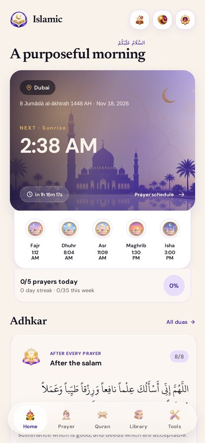 <br /> **Home** — next prayer, today's five, ayah of the day | 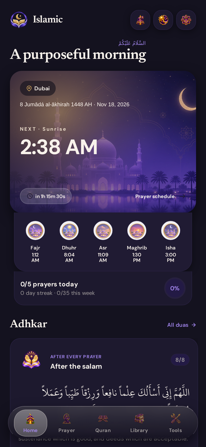 <br /> **Home in dark theme** |
| 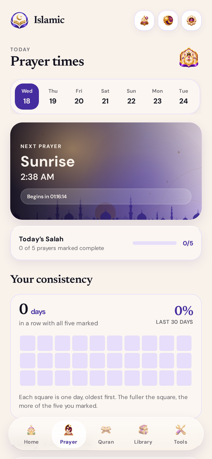 <br /> **Prayer times** — today's six with a live countdown | 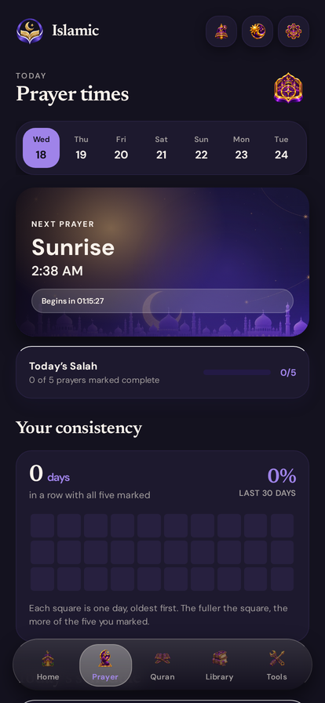 <br /> **Prayer times in dark theme** |
| 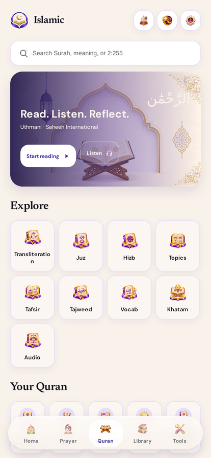 <br /> **Qur'an** — reader, juz, hizb, topics, tafsir, audio | 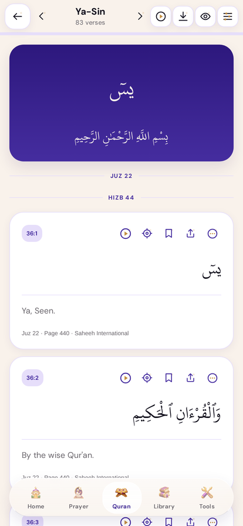 <br /> **Reader** — Uthmani text with translation |
| 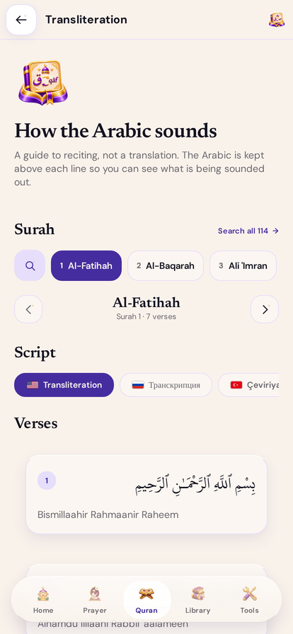 <br /> **Transliteration** — how the Arabic sounds | 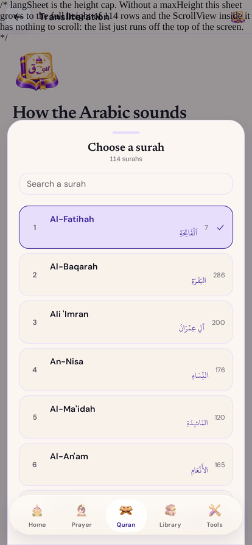 <br /> **Surah picker** — search all 114 |
| 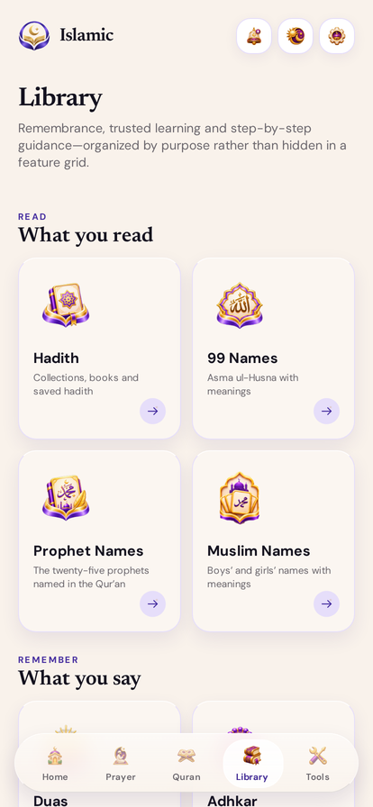 <br /> **Library** — what you read, recite and remember | 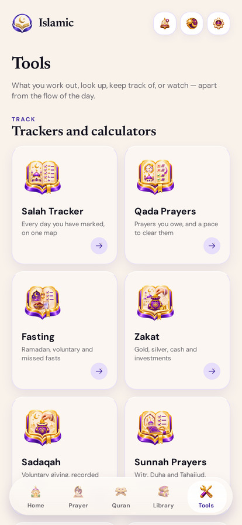 <br /> **Tools** — trackers and calculators |
| 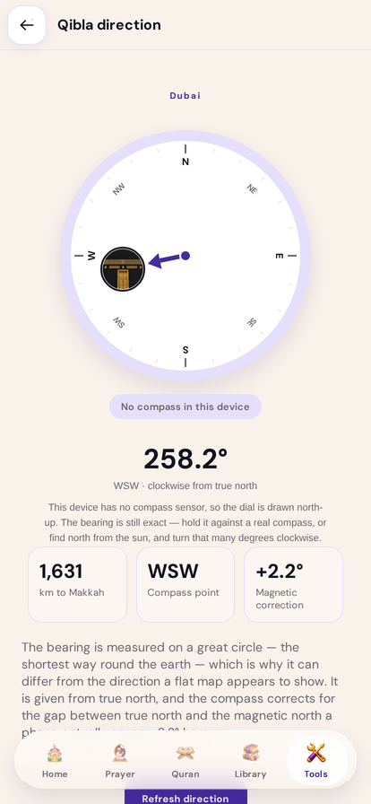 <br /> **Qibla** — dial, Kaaba marker, sensor honesty | 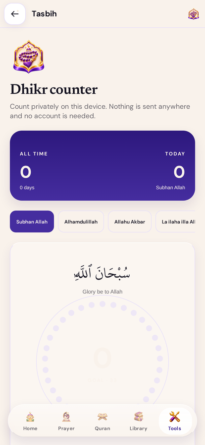 <br /> **Tasbih** — a quiet dhikr counter |

### Settings, sharing and Focus-only pinch zoom

Actual running production web captures at **390 × 844**, not native-device
screenshots or redesigned mock-ups. Settings and Share App show the latest R105
update; the unchanged Focus captures document R104.

| | |
| :--- | :--- |
| 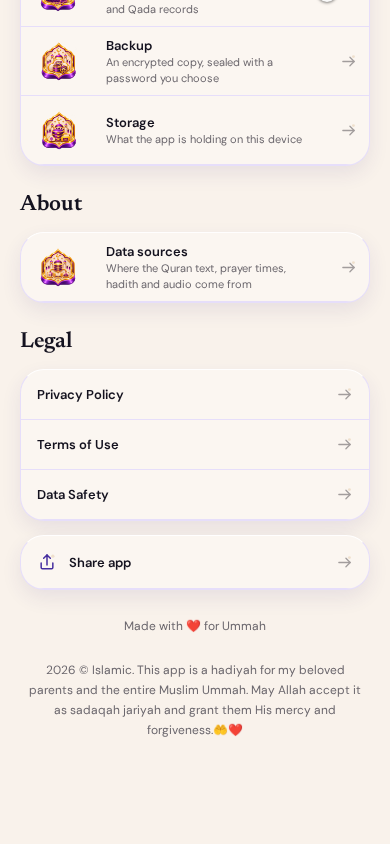 <br /> **Settings / English** — dedication at the very end | 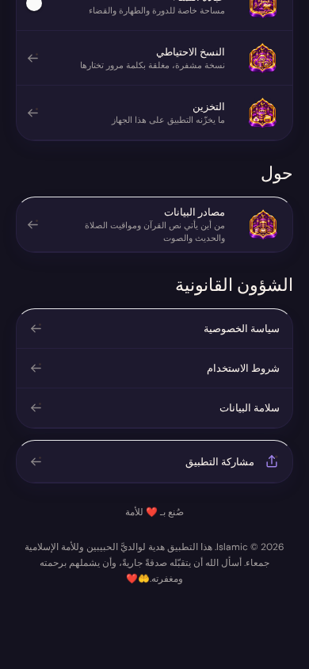 <br /> **Settings / Arabic** — complete, wrapping RTL dedication |
| 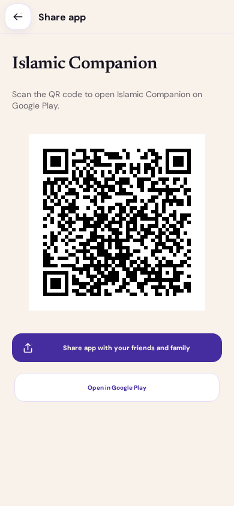 <br /> **Share app** — QR and sharing, without the printed URL | 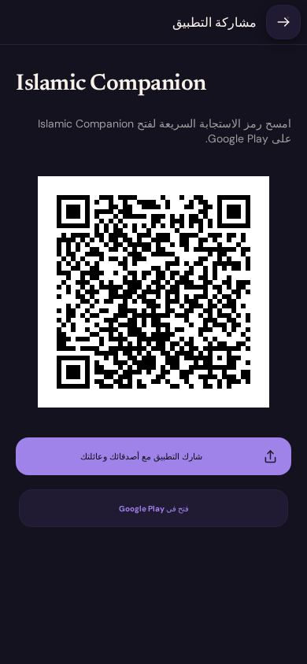 <br /> **Arabic / dark** — the QR stays black on white |
| 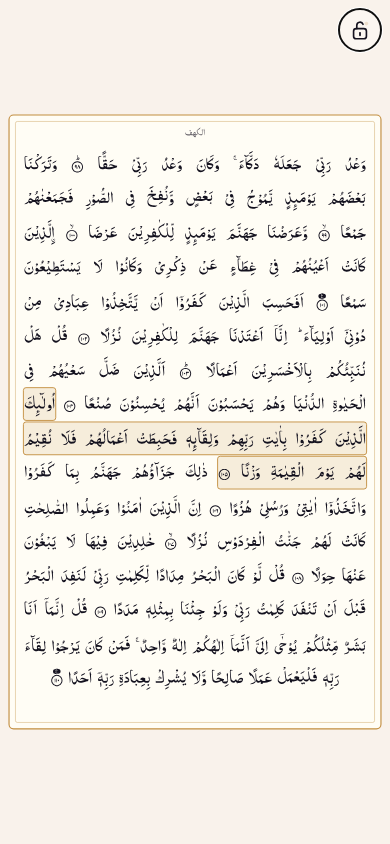 <br /> **Focus at fit** — original whole printed page | 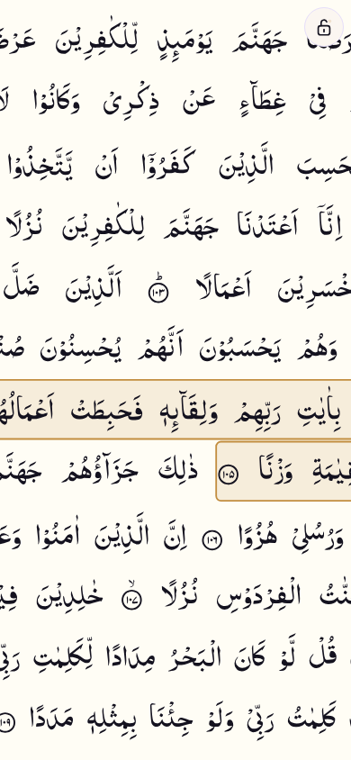 <br /> **Pinch magnification** — pan to read the enlarged page; Unlock stays fixed |

[Current Settings/sharing checks and all six captures](docs/settings-share-r105.md) ·
[Self-contained Settings/sharing gallery](docs/settings-share-r105-gallery.html) ·
[Focus behavior and R104 baseline](docs/share-focus-r104.md)

**Large-screen assets:** [Download 24 tablet and unfolded-foldable screenshots](docs/store-assets/Islamic-tablet-foldable-screenshots.zip)
(8 per category). These are independently rendered **web-build viewport captures**, not
native Android emulator screenshots. [Sizes, provenance and reproduction steps](docs/store-assets/README.md).

---

## Features

The app is organised into five tabs. Nothing in one tab is repeated in another: Prayer
holds the times and everything derived from them, Library holds what you read and
remember, Tools holds what you calculate, look up, travel for, or record. Settings opens
from the control at the right of the shared header, alongside notifications and the theme
toggle.

### Home

- A greeting that matches the time of day, and the next prayer with a live countdown
- Today's five prayers at a glance, each markable as prayed
- Streaks — current day streak and the week's tally against the target
- **Ayah of the day**, openable into a full reflection and shareable as an image card
- Quick actions straight to **Qur'an**, **Qibla**, **Tasbih** and **Audio**
- Daily content surfaced for the day, and the worship tools you have chosen to keep here

### Prayer

- **Prayer times** for the city you choose — Fajr, Sunrise, Dhuhr, Asr, Maghrib and Isha — with the current and next prayer worked out for you
- **Seven calculation methods**: UAE (IACAD, the default), Gulf Region, Umm al-Qura, Muslim World League, Egyptian Authority, Karachi and North America
- **Adhan and reminders** — six adhan voices plus two Fajr calls, per-prayer toggles, scheduled ahead in a queue so they fire without a network
- **Qibla** — see below; this is the part most compass apps get wrong
- **Hijri calendar** with the month grid, and Gregorian conversion
- **Ramadan** — suhoor and iftar timetable, a fasting record, and the guides
- **Ramadan Planner** — which fasts your cycle may claim, and when they fall due
- **Fasting** — Ramadan, voluntary and missed fasts in one record
- **Qada Prayers** — what you owe and a pace to clear it
- **Qada Fasts** — what you owe, and what you have made up
- **Salah Tracker** — every day you have marked, on one map
- **Sunnah Prayers** — Witr, Duha and Tahajjud, kept apart from the five
- **These Days** — what stays open when the prayer and the fast are lifted
- **Weekly Summary** — your past seven days at a glance
- **Location** — search for a city or enter coordinates by hand. The app has no GPS permission and never asks for one

#### Qibla, in detail

A phone magnetometer finds **magnetic** north. A qibla bearing is measured from **true**
north. The gap between them — magnetic declination — is about 2° in Dubai, 12° in New
York, 15° in Seattle and 22° in São Paulo, and it changes year by year. An app that draws
the true bearing against a raw magnetometer reading is wrong by exactly that amount:
small enough in Britain to go unnoticed, large enough in the Americas to point at the
wrong wall.

This app ships the **World Magnetic Model 2025–2030** on the device and corrects for it,
and shows the correction it applied. It also judges the sensor rather than trusting it:
field strength outside the earth's 25–65 µT band means something in the room is adding to
it, and a jittering angle means an uncalibrated sensor, so the screen says so and asks you
to sweep the phone in a figure of eight. Where there is no magnetometer at all, the dial
is drawn honestly north-up with the exact bearing instead of pretending to be live. In
Makkah itself the dial is replaced by a short note: every direction here is the Qibla.

### Qur'an

- **Reader** — all 114 surahs in Uthmani script, verse by verse, with a translation beside the Arabic
- **16-line Quran** — **Quran → Explore**, a separate offline Taj Company IndoPak edition: 548 original pages, source line breaks, matching Nastaleeq typography, top-page navigation, lightweight paper-fold swipes, one responsive **Go to** picker for **Surah / Juz / Verse**, full-page **Focus mode** with a top-right **Unlock** button, memoized page rendering, independent saved pages, inline ayah actions, playback-follow highlighting and an exact continue-reading marker. Focus hides the header, controls and mini-player without stopping recitation, and supports **pinch zoom from 1× to 3× with panning only while in Focus**. Unlock, rotation or a different printed page resets the transient magnification; normal mode and stored reader settings remain unchanged. [Share/zoom behavior and checks](docs/share-focus-r104.md); [original implementation](docs/offline-indopak-16-r94.md); [resource permissions and original notices](resources/quran/indopak-taj-16/NOTICE.md).
- **Four Arabic scripts** — Uthmani, Imla'i simple, IndoPak and Tajweed
- **484 translations** and every tafsir; **Tafsir** on its own, and **Tafsir Compare** side by side
- **Transliteration** — how the Arabic sounds, with a picker that searches all 114 surahs by number, Latin name, Arabic name or meaning
- **Audio** — background listening with whole-surah reciters and verse-by-verse playback; the player has a persisted **Translation audio On/Off** switch and all **11 spoken translations**. Choosing a new voice switches the active translated ayah immediately, without another Play tap, while keeping reader text translation independent. [Behavior, real-browser checks and native-validation limits](docs/audio-player-translation-r103.md).
- **Search** across the whole Qur'an
- **Bookmarks** and **Notes** with a full note editor
- **Memorize**, **Memorize Test** and **Hifz** for revision
- **Khatam** — progress through a complete reading
- **Reading Plans** to pace one
- **Juz** and **Hizb** directories
- **Qur'an Topics** with a topic detail view
- **Qur'an Vocabulary** and **Tajweed Study**
- **Reader Settings** — script, translation, fonts and sizes
- **Downloads** and **Qur'an Preload**, so the text is on the device before you need it
- **Share a verse** as a designed image card

### Library

- **Duas** — Hisn al-Muslim arranged by occasion, browsable by category
- **Adhkar** — morning and evening remembrance
- **99 Names** — Asma ul-Husna, with meanings (Arabic meanings written in, because the catalogue omits them)
- **Prophet Names** — the twenty-five prophets named in the Qur'an
- **Muslim Names** — boys' and girls' names with their meanings
- **Hadith** — ten collections: Sahih al-Bukhari, Sahih Muslim, Sunan Abu Dawud, Jami' at-Tirmidhi, Sunan an-Nasa'i, Sunan Ibn Majah, Muwatta Malik, Forty Hadith of an-Nawawi, Forty Hadith Qudsi and Forty Hadith of Shah Waliullah — browsable by book, graded where the collection carries grades, with saved hadith and a shareable card
- **Worship guides** — wudu, salah, janazah and more, step by step
- **Purity** and **Ghusl** — the full washing, step by step
- **Ramadan** reading for the month

### Tools

| | |
| :--- | :--- |
| **Salah Tracker** — every day you have marked, on one map | **Qada Prayers** — prayers you owe, and a pace to clear them |
| **Fasting** — Ramadan, voluntary and missed fasts | **Zakat** — gold, silver, cash and investments |
| **Sadaqah** — voluntary giving, recorded privately | **Sunnah Prayers** — Witr, Duha and Tahajjud |
| **Tasbih** — a quiet, tactile dhikr counter | **Journal** — a private place to reflect |
| **Weekly Summary** — your past seven days | **Qibla** — direction to the Ka'bah |
| **Location** — search a city or set coordinates | **Hijri Calendar** — Islamic dates and the month grid |
| **Prayer Reminders** — adhan alerts and toggles | **Umrah Resources** — a packing checklist you can tick off |
| **Women's worship** — cycle, purity, the fasts you owe | **Cycle Tracker** — period logging and predictions |
| **Istihada** — bleeding that is not a period | **Ramadan Planner** — which fasts your cycle may claim |
| **These Days** — what stays open | **Qada Fasts** — what you owe and have made up |

Also here: **Holy site channels** — live broadcasts from Makkah and Madinah (Quran TV,
Alharamain, Sunnah TV and Makkah Live) — **Privacy Lock** (face, fingerprint or PIN in
front of the app), **Backup** (encrypted, and yours to keep), **Storage**, **Data sources**
(every service the app talks to, listed in plain words), **My Reports** and **Legal**.

### Normal Quran reader scrolling

The normal reader uses **measured variable-height virtualization**, not fabricated fixed ayah offsets. The blank-window regression after ayahs 13–14 is reproduced on the old build and fixed on the current one; complete Ar-Rahman and Al-Baqarah scans, distant reference jumps and Continue Reading are covered. [Cause, checks and actual before/after screenshots](docs/quran-reader-scroll-r106.md) · [Offline gallery](docs/quran-reader-scroll-r106-gallery.html).

### Settings and sharing

- **Share app**, immediately below Privacy Policy / Terms of Use / Data Safety, with a bundled scannable QR for [Islamic on Google Play](https://play.google.com/store/apps/details?id=com.qashi.islamic).
- **“Share app with your friends and family”** opens the platform share flow. Unsupported web browsers can copy the link; cancellation/errors are not presented as successful sharing. The raw URL is **not printed on the screen**; the QR, shared/copied message and separate Google Play action keep the same destination.
- Share App titles, explanations, actions and statuses cover **all 22 interface languages**, light/dark and RTL. Long Share App titles wrap on narrow screens; failure guidance offers retry or Google Play rather than referring to a removed link.
- The **very end of Settings** has the publisher’s dedication to their beloved parents and the entire Muslim Ummah, localized in all 22 interface languages, with the exact supplied English wording, fixed **2026 © Islamic.** branding and **🤲❤️** ending.
- No QR-service request, contact access, tracking, new dependency or user-data migration is added. [Current checks and screenshots](docs/settings-share-r105.md).

### Widgets and Live Activities

Four widget families — **Prayer**, **Ayah**, **Hijri** and **Tasbih** — plus an iOS
**Live Activity** for the next prayer. They are drawn by the operating system, not by the
app, so everything they need arrives pre-formatted: times as strings in the user's clock
style, the Hijri date already written, the palette named. A widget that recalculates
anything will eventually disagree with the app, so none of them do. Data moves through the
App Group `group.com.qashi.islamic`.

### Languages

The interface is fully translated into **22 languages**, with true right-to-left layouts
for Arabic, Urdu, Persian and Pashto:

English · العربية (Arabic) · اردو (Urdu) · Français · Türkçe · Русский · 中文 · فارسی ·
Ўzbekcha · Қазақша · Tiếng Việt · Azərbaycan · Bosanski · Български · සිංහල · پښتو ·
বাংলা · Bahasa Indonesia · தமிழ் · हिन्दी · മലയാളം · Bahasa Melayu

Qur'an translations, tafsir and recitation voices are chosen separately from the interface
language, so you can read an English interface with an Urdu translation and a Cairene
reciter.

### Privacy

- **No account, no sign-up, no analytics, no tracking.** The app has no profile to build
- Everything is stored on the device in AsyncStorage
- Location is a city you choose. Precise location is never requested, stored or sent — with no location chosen the app uses Makkah rather than silently guessing
- Notifications are scheduled on the device
- Backups are **encrypted** before they leave, and restoring one is your choice

### Design

- **Light and dark themes**, plus a distinct visual treatment for the app's scenes
- A **custom SVG icon system** (`src/components/CustomIcon.tsx`) with 396 tool and feature icons drawn as lossless WebP
- **A shared motion system** (`src/design/motion`) — press depth, entrance springs and reduced-motion support handled in one place
- **Typography bundled on the device**: DM Sans, Newsreader, Noto Naskh Arabic, Amiri, Amiri Quran, KFGQPC Uthmanic Hafs, Scheherazade New, IBM Plex Sans Arabic, Noto Kufi Arabic and Be Vietnam Pro
- **Haptics** on the interactions that warrant them

---

## Branding

The logo, wordmark and every app icon variant live in [`branding/`](./branding) so they can
be found without hunting through `assets/`. They are the same files the build uses.

<div align="center">
  
  &nbsp;&nbsp;&nbsp;
  
  &nbsp;&nbsp;&nbsp;
  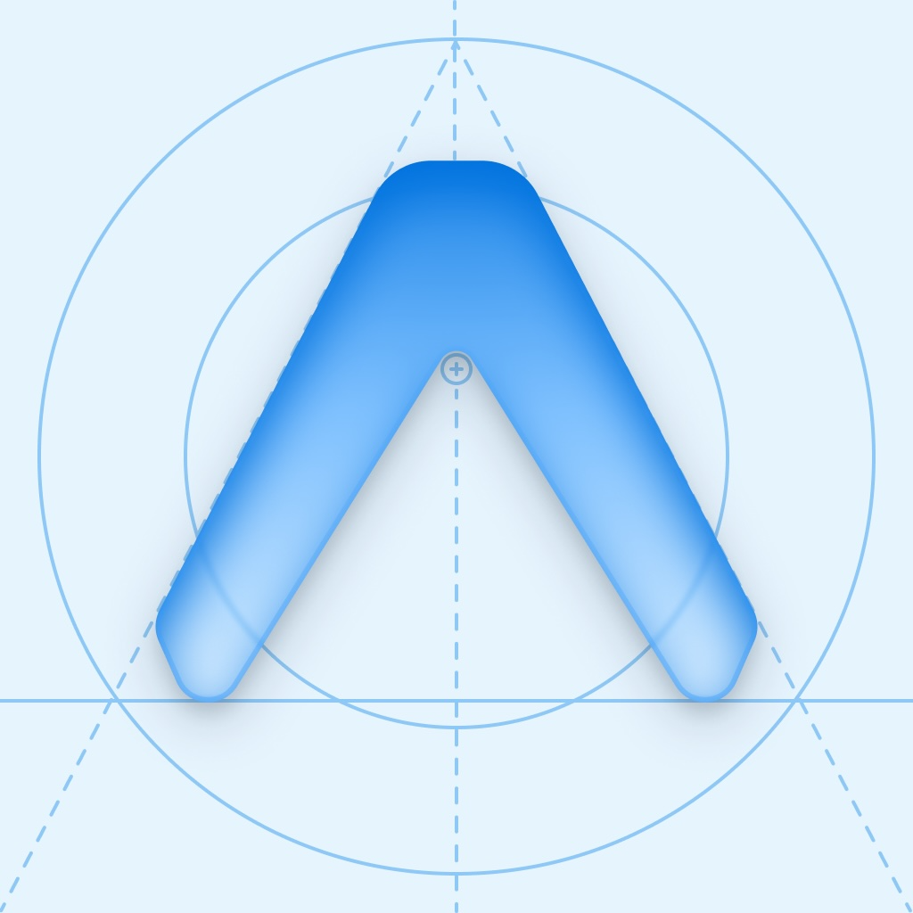
</div>

| File | Size | Used for |
| :--- | :--- | :--- |
| `logo-mark.png` | 256 × 256 | Primary logo mark |
| `logo-mark-palestine.png` | 256 × 256 | Logo mark, Palestine variant |
| `app-icon.png` | 1024 × 1024 | Default app icon |
| `ios-icon-light.png` | 1024 × 1024 | iOS icon, light appearance |
| `ios-icon-dark.png` | 1024 × 1024 | iOS icon, dark appearance |
| `android-icon-foreground.png` | 1024 × 1024 | Android adaptive icon, foreground layer |
| `android-icon-background.png` | 1024 × 1024 | Android adaptive icon, background layer |
| `android-icon-monochrome.png` | 1024 × 1024 | Android themed (monochrome) icon |
| `splash-icon.png` | 512 × 512 | Splash screen |
| `favicon.png` | 96 × 96 | Web favicon |

<div align="center">
  
  
  
  
  
  
</div>

The brand colour is the deep indigo `#2D187D`, used for the splash and the Android
adaptive-icon background.

---

## Getting started

Requires **Node 22.13+** (the toolchain warns on anything older).

```bash
npm install
npx expo start
```

Then press `i` for iOS, `a` for Android, or `w` for web. You can also scan the QR code
with Expo Go.

| Script | What it does |
| :--- | :--- |
| `npm start` | Start the Expo dev server |
| `npm run android` | Open on Android |
| `npm run ios` | Open on iOS |
| `npm run web` | Open in a browser |
| `npm run build:web` | Export a static web build to `web-build/` |

The first run asks for a prayer location. That is deliberate: there is no silent
fallback and no guessed city.

## Building for the stores

The store builds run through **EAS**, configured outside this repository — there is no
`eas.json` here on purpose. From this checkout:

```bash
npm install -g eas-cli && eas login
eas build --platform android --profile preview      # APK to install
eas build --platform android --profile production   # AAB for Google Play
eas build --platform ios --profile production       # IPA for TestFlight
```

---

## Data sources

| Source | Used for |
| :--- | :--- |
| **The app's own server** — `api.islamicdata.uz` | Every Arabic script — Uthmani, Imla'i simple, IndoPak and Tajweed — all 484 translations and every tafsir, the surah / juz / hizb structure, transliteration, Qur'an search, and the ten hadith collections. Overridable with `EXPO_PUBLIC_QURAN_API_BASE_URL` |
| `audio.islamicdata.uz` | The full-surah reciter catalogue, and both adhan catalogues |
| `cdn.islamic.network` | Kept verse-by-verse recitation audio |
| The app's own price service | Spot gold and silver prices for the nisab threshold, daily exchange rates for Zakat, and city search |
| `api.islamic.app` | Adhkar and duas (Hisn al-Muslim), and the Names catalogue |
| YouTube and Makkah Live | Live broadcasts from the two holy mosques |
| **On the device — no request at all** | Prayer times, the Hijri date, the Ramadan timetable, magnetic declination, the 604-page layout with its juz and hizb divisions, and every adhan recording |

Prayer times are **calculated on the device** by the `adhan` library, from the coordinates
of the city you chose — there is no network request in the timetable you rely on, which is
why it works on a plane. Magnetic declination is likewise computed on the device from the
bundled World Magnetic Model. The adhan recordings ship inside the app, which is what lets
the call sound at Fajr with no connection at all.

Every service the app talks to is also listed in-app, under **Tools → Data sources**.

---

## Tech stack

| | |
| :--- | :--- |
| **Framework** | Expo ~58, React Native 0.88, React 19 |
| **Language** | TypeScript 6 |
| **Navigation** | React Navigation 7 (bottom tabs + native stacks) |
| **Prayer times** | `adhan` 4.4 — computed on device |
| **Compass** | `expo-sensors`, corrected with a bundled WMM 2025–2030 implementation |
| **Audio** | `expo-audio`, background playback enabled |
| **Notifications** | `expo-notifications`, scheduled by a device-side queue |
| **Storage** | `@react-native-async-storage/async-storage` |
| **Privacy lock** | `expo-local-authentication` |
| **Widgets** | Native SwiftUI targets via `@bacons/apple-targets` |
| **Web** | `react-native-web` — the same code runs in a browser |

Native glue lives in `plugins/` (adhan alarms, battery exemption, permission trimming,
widgets) and `modules/deen-widgets/`.

---

## Project layout

```
App.tsx                  the application: screens, navigation, styles
index.ts                 entry point
app.json                 Expo configuration, icons and splash
assets/                  fonts, icons, scenes, adhan audio
branding/                logo and app icon variants
docs/
  SOURCES.md             where every piece of content comes from
  widgets.md             how the widgets and Live Activity are wired
  audio-worker/          the audio catalogue worker
  screenshots/           the screens shown above
src/
  components/            shared components (icon system, share cards)
  content/               journeys, worship guides, names, study material
  data/                  bundled datasets
  design/                palette, type scale, motion system
  services/              API clients, storage, prayer times, hadith, zakat, …
plugins/                 Expo config plugins
modules/deen-widgets/    native widget module (iOS + Android)
targets/widgets/         SwiftUI widget and Live Activity sources
```

## Further reading

- [`docs/SOURCES.md`](./docs/SOURCES.md) — where the content comes from, and how it is checked
- [`docs/widgets.md`](./docs/widgets.md) — the widget contract and data flow
- [`docs/audio-worker/`](./docs/audio-worker) — the recitation catalogue worker
